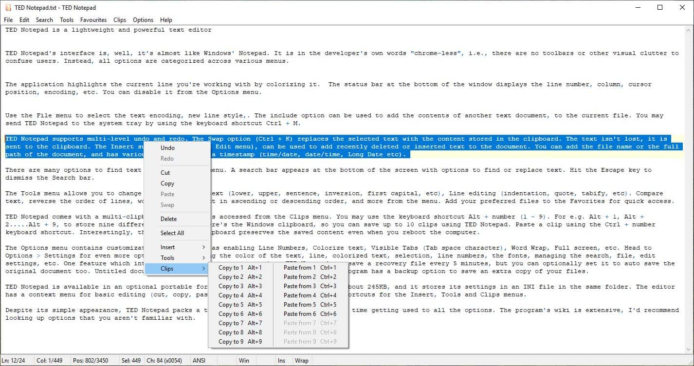
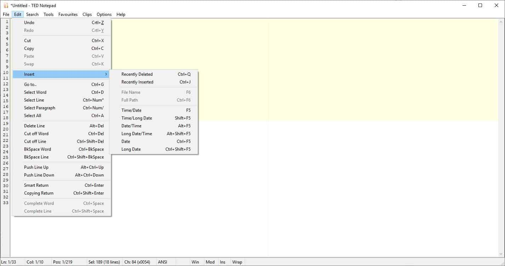

# TED Notepad Portable Advanced Text Editor

[](https://github.com/ted-notepad-portable/ted-notepad/releases/)

TED Notepad is a lightweight portable plain-text editor for Microsoft Windows. It combines a familiar notepad interface with fast text-processing tools, keyboard commands, large-file support and multiple clipboard utilities.

## Features

- Portable operation without a required installation.
- Fast startup and a compact footprint.
- Plain-text editing for notes, scripts and source files.
- Support for very large documents in the 64-bit edition.
- Hundreds of text-processing functions.
- Regular expression search and replacement.
- Multiline search and editing tools.
- Grep and pattern-based filtering.
- Sorting and reversing operations.
- Word auto-completion.
- Multiple permanent clipboards.
- Clipboard collection and monitoring.
- Bookmarks and favorite files.
- Line and character navigation.
- URL detection and link handling.
- Automatic `.LOG` timestamps.
- Encoding and line-ending controls.
- Minimize-to-tray behavior.
- Portable configuration storage.



## Editing tools

TED Notepad is designed around quick operations that can be reached from menus, keyboard shortcuts and command-line parameters.

| Tool group | Typical use |
| --- | --- |
| Search | Find text, patterns and repeated terms |
| Replace | Modify matching text across a document |
| Grep | Keep or remove lines matching a pattern |
| Sort | Order lines using configurable rules |
| Reverse | Reverse lines, words or selected text |
| Selection | Select ranges by line or character position |
| Clipboard | Store and reuse several text fragments |
| Navigation | Jump to lines, columns and document positions |

## Large-file editing

The 64-bit edition uses a tree-based text storage architecture intended for documents that are much larger than those normally handled by a basic notepad.

Large-file work can be organized as follows:

```text
open the document
choose the required encoding
search or filter the content
apply a focused text operation
save a new copy
```

The available memory and file encoding still affect practical limits.

## Portable workflow

TED Notepad can run from a removable drive or a user-selected folder. A portable folder can contain the executable, manual and configuration files together.

Portable use is useful when:

- The same editor is used on several Windows computers.
- Settings should remain beside the application.
- No system-wide installation is desired.
- A small tool is needed for technical documents.
- The editor must be carried on removable storage.



## Search and replacement

The editor supports ordinary text search, regular expressions, multiline matching and replacement operations.

A typical workflow is:

```text
select a search mode
enter a phrase or regular expression
review the matching lines
replace selected occurrences
save the edited document
```

Search results can be combined with filtering, sorting and line-processing commands.

## Clipboard tools

TED Notepad includes several permanent clipboards for storing reusable fragments. Clipboard utilities can support repetitive editing, text collection and quick insertion.

Clipboard monitoring can be used to collect copied text into the current document. Separators, timestamps and startup behavior can be adjusted in the application settings.

## File and encoding support

The editor is intended for plain-text files and supports configurable loading and saving behavior.

| Area | Examples |
| --- | --- |
| Encodings | ANSI, Unicode and UTF-8 variants |
| Line endings | Windows, Unix and classic Mac styles |
| File markers | `.LOG` and other content flags |
| Navigation | Line, column and character positions |
| Documents | Notes, logs, scripts and source text |
| Storage | Portable settings beside the executable |

## Command-line workflow

TED Notepad supports command-line parameters for opening files and controlling navigation.

```bat
TedNPad.exe document.txt
TedNPad.exe /l 250 /c 12 document.txt
TedNPad.exe /s "pattern" document.txt
```

The exact switch names and combinations depend on the installed release and its manual.

## Interface

The interface keeps a classic Windows notepad appearance while exposing advanced tools through menus and shortcuts.

Available interface functions include:

- Multiple document windows.
- Favorite files.
- System-tray minimization.
- Configurable hotkeys.
- Status information.
- Search history.
- Recent-file access.
- Adjustable display options.
- Context menus for editing commands.

## System requirements

TED Notepad is designed for Microsoft Windows.

The current release provides:

- Unicode and ANSI editions.
- 32-bit packages for legacy systems.
- 64-bit packages for modern systems.
- Portable and installer packages.
- Windows compatibility that includes current systems and older supported versions.

## Source layout references

The following real files are used as repository-layout references:

- [AUTHORS](AUTHORS)
- [ChangeLog](ChangeLog)
- [COMMITTERS](COMMITTERS)
- [geany.desktop.in](geany.desktop.in)
- [geany.exe.manifest](geany.exe.manifest)
- [geany.gladep](geany.gladep)
- [geany.pc.in](geany.pc.in)
- [index.md](index.md)
- [Makefile.am](Makefile.am)
- [meson_options.txt](meson_options.txt)
- [m4/ax_cxx_compile_stdcxx.m4](m4/ax_cxx_compile_stdcxx.m4)
- [m4/geany-gtk.m4](m4/geany-gtk.m4)
- [plugins/geanyfunctions.h](plugins/geanyfunctions.h)
- [plugins/geanyplugin.h](plugins/geanyplugin.h)
- [plugins/meson.build](plugins/meson.build)
- [scripts/create_c_tags.sh](scripts/create_c_tags.sh)

## Configuration

Settings are kept in the application configuration area and can be adjusted through the settings dialog.

Configuration areas include:

- File loading and saving.
- Encoding detection.
- Line-ending behavior.
- Search and replacement options.
- Clipboard settings.
- Hotkeys.
- Window placement.
- Tray behavior.
- Favorite files.
- Display preferences.

## Limitations

TED Notepad is a plain-text editor rather than a word processor or full integrated development environment.

It does not focus on:

- Rich document formatting.
- Embedded media.
- Collaborative editing.
- Project build systems.
- Integrated debugging.
- Version-control management.
- Visual layout design.

## License and use

TED Notepad is freeware created for personal text editing and advanced plain-text processing.

Users should review the license and distribution terms supplied with the version they use, especially when deploying the editor in commercial environments.

## Related Search Terms

ted notepad, ted notepad portable, ted notepad text editor, ted notepad 64 bit, ted notepad large file editor, text-editor, portable-software, windows, plain-text, regex, clipboard, large-files, notepad-alternative
